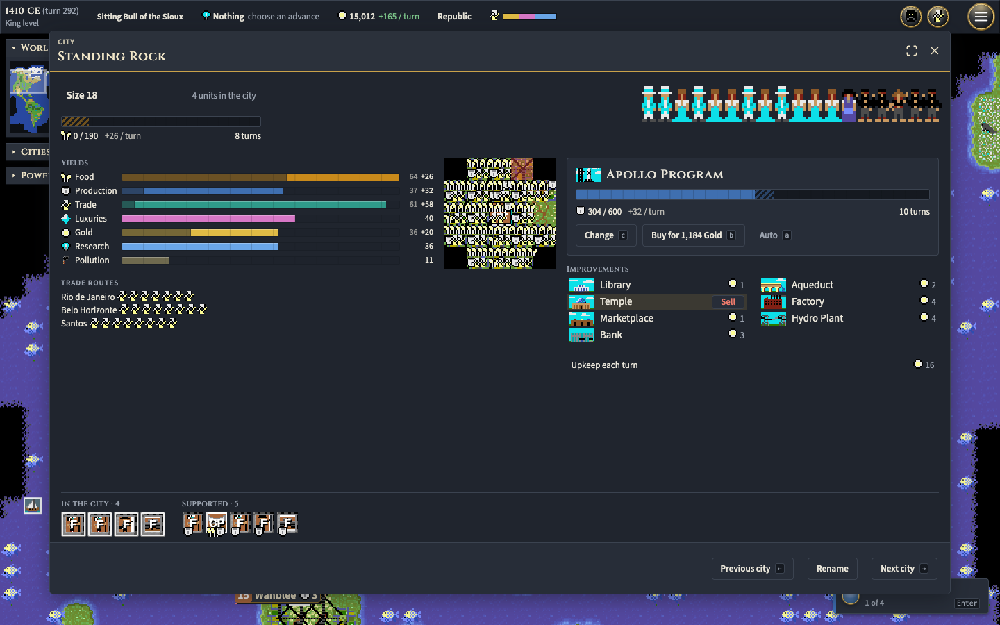
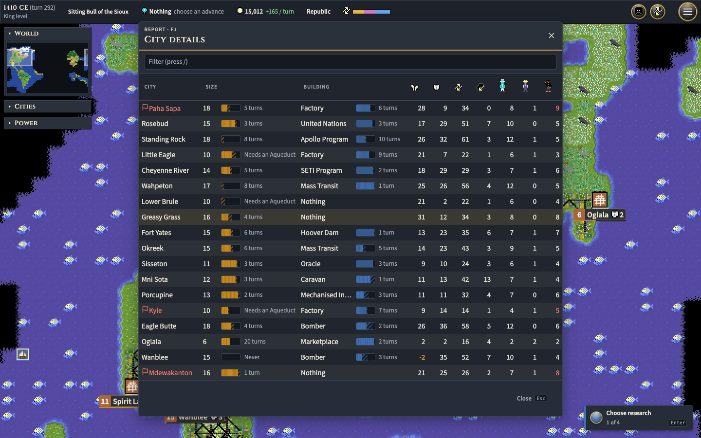
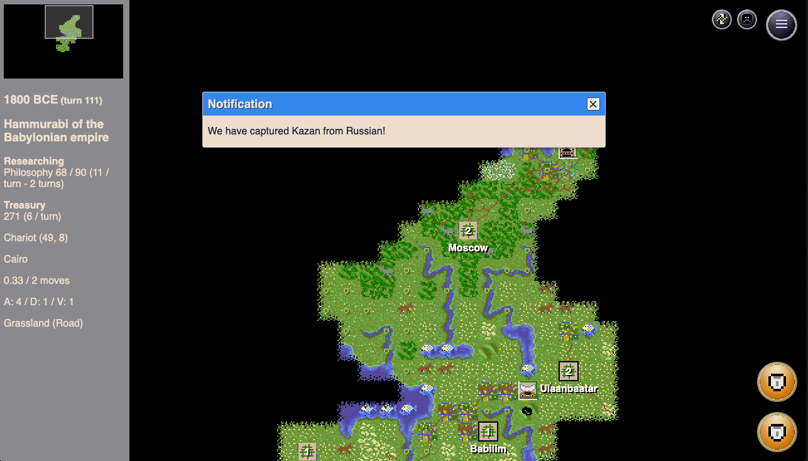
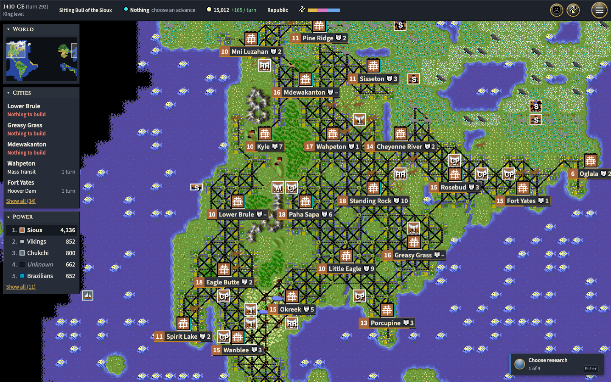
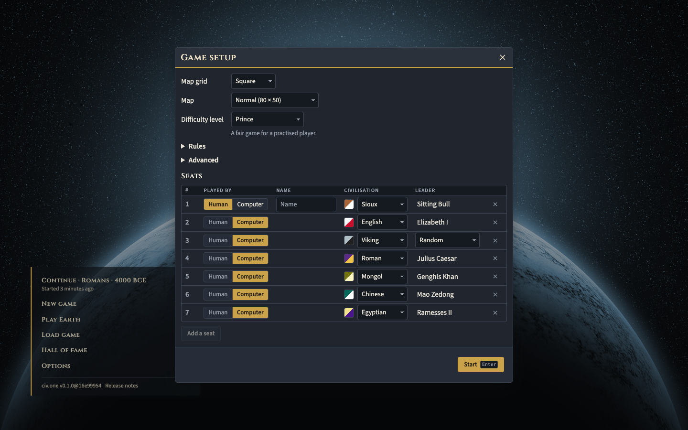
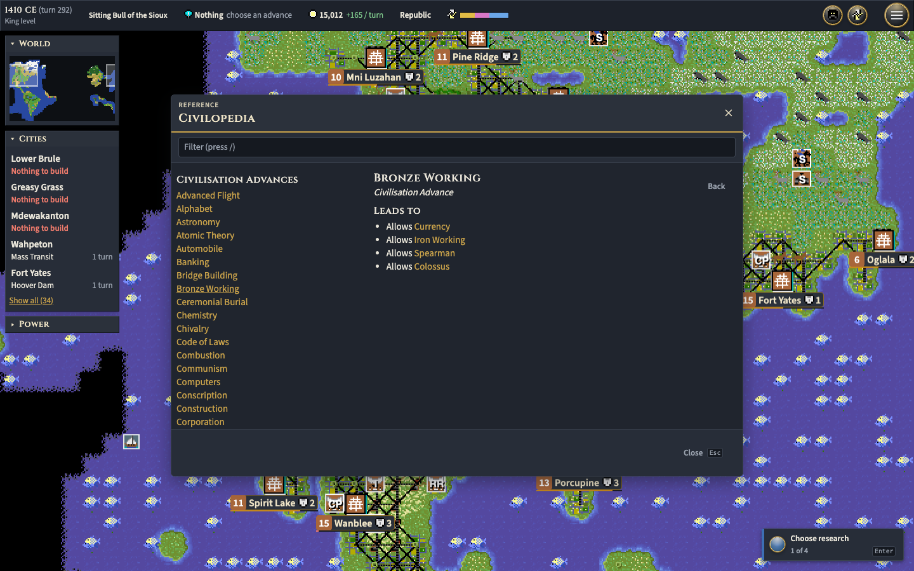
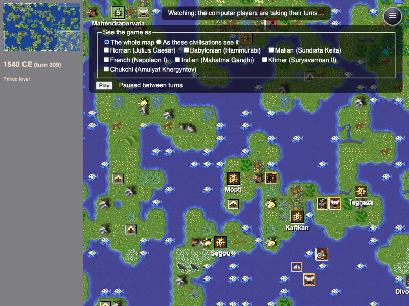
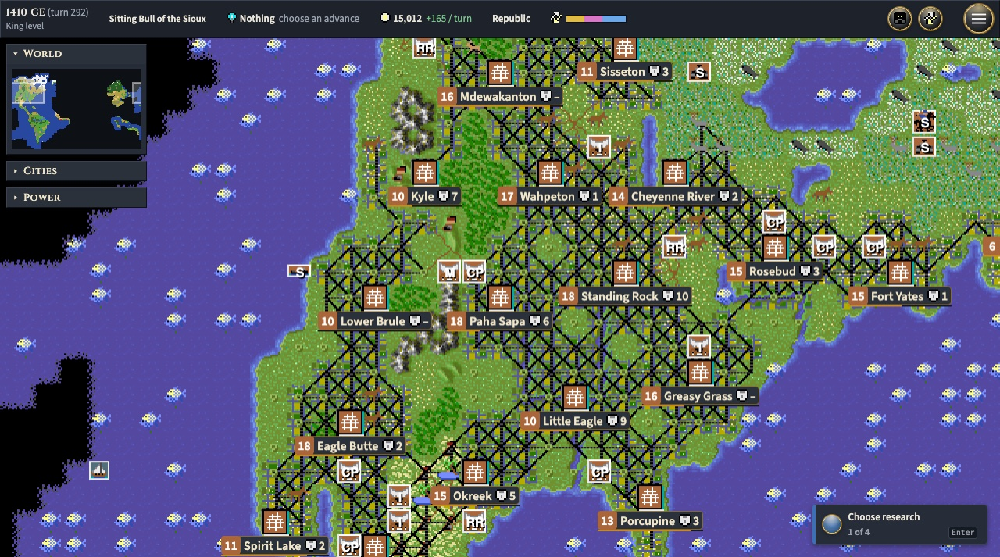
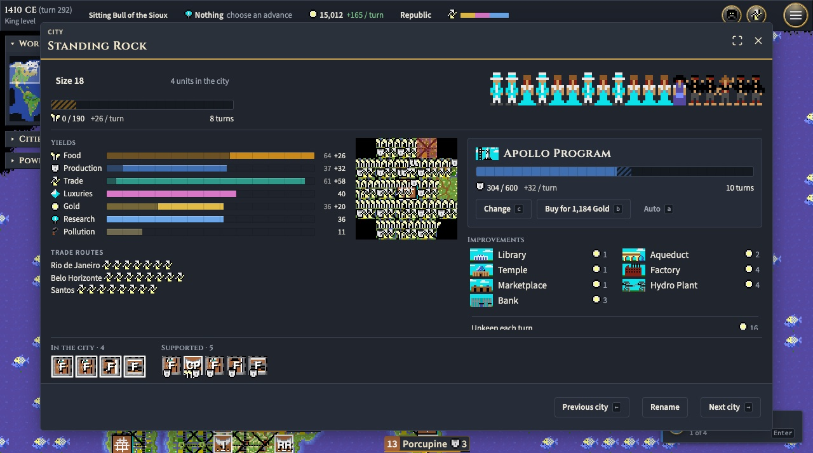
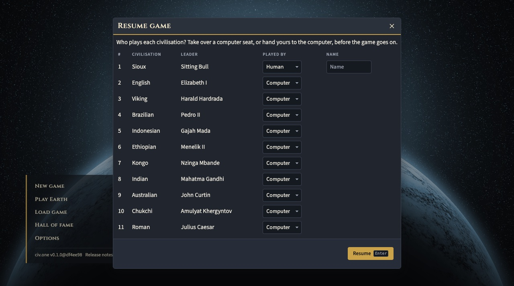

# History

How civ-clone got from an Electron experiment in February 2016 to the game at
[civ.one](https://civ.one). Written on 9 November 2026 from the git history of
[`dom111/civ-clone`](https://github.com/dom111/civ-clone) and of the
repositories in this organisation.

## In numbers

As of 9 November 2026:

- **129 months** since the first dated snapshot, 12 February 2016.
- **3,370 commits** across both homes, not counting generated deploy builds or
  dependency bumps. **2,267 of them (67%)** were made since 1 September 2026.
- **402 repositories** in this organisation, 171 of them pushed to in 2026.
- **714 pull requests** merged across the organisation, 711 of them since
  September 2026.
- `web-renderer`'s source grew from 12,013 lines in May 2023 to 53,725, and its
  `npm test` runs 185 suites.

Commits per year:

| Year | Commits | Where |
| ---- | ------: | ----- |
| 2016 | 6 | `dom111/civ-clone` (pushed later, see below) |
| 2017 | 13 | `dom111/civ-clone` |
| 2018 | 12 | `dom111/civ-clone` |
| 2019 | 8 | `dom111/civ-clone` |
| 2020 | 53 | `dom111/civ-clone` |
| 2021 | 392 | this organisation, all in the first quarter |
| 2022 | 455 | this organisation |
| 2023 | 142 | this organisation, January to May |
| 2024 | 0 | |
| 2025 | 4 | |
| 2026 | 2,285 | this organisation: 18 to June, 852 in July to September, 1,415 since |

The first 19 commits were pushed in bulk on 1 February 2017 and are counted by
the date in their message ("Changes from 2016-02-12"). Organisation commits are
counted by commit date on each default branch, which puts the autumn 2020
module split in early 2021.

## 2016: basic engine ideas, shown in Electron

Six snapshots over four weeks in February and March. The earliest already sets
out the plan that never changed: a small core, with everything else supplied by
plugins. By 10 March there was a renderer, a keyboard plugin, the start of
notifications, and data for extracting the original game's artwork.

> Changes from 2016-02-12 - Basic game engine ideas - using electron to display game

## 2017: everything becomes a plugin, and the code goes on GitHub

Ten months later the work resumed. Almost all core components moved out into
plugins, and combat, unit colouring and a fog-of-war layer arrived. On
1 February 2017 the whole history was published as
[`dom111/civ-clone`](https://github.com/dom111/civ-clone).

## 2018: one day, twelve commits

On 30 May 2018 the code was converted to ES6. Advances and units changed from
JSON files to classes, terrain gained distribution data, a basic world
generator appeared, and there was a stub for an AI player. Then another year of
silence.

## 2019 to 2020: the first rewrite, into the terminal

June 2019: "Start moving away from Electron." The first major rewrite landed on
27 December 2019, along with GitHub Actions. January to April 2020 was the
busiest spell of the first four years, with 51 commits, most titled simply
"Incremental updates". The game was played by AI only and watched as a coloured
ASCII map in the terminal.

> Currently the game is unplayable by a human player, but I'm working on making
> a simple decision-based AI that is helping me check the current state of the
> rules and mechanics.

No screenshots survive from 2016 to 2020: the original repository never
contained an image.

## Autumn 2020: the second rewrite, into modules and TypeScript

Pull request #1 on the old repository, "rewrite-as-modules", was merged on
28 September 2020. The same day `core-registry` was created in this
organisation. By New Year there were 186 repositories: `core-*` for concepts,
`base-*` for single units, actions and civilizations, and `civ1-*` for the
original game's rules.

## 2021: a renderer you can play

392 commits in one quarter. `simple-ai-client` started on 11 February and
[`electron-renderer`](https://github.com/civ-clone/electron-renderer) on the
16th. Two days later it "works", without graphics. By the 22nd it drew the map
from the original game's files, and on 5 March `civ1-asset-extractor` automated
that. The old monorepo was marked as no longer developed. Nothing more happened
until the following February.

## 2022: the rest of the game, then the browser

- **25 February:** the rest of the tech tree and the modern units each got a
  repository, 59 of them in one day.
- **March:** city improvements, the Wonders, railroads, unit support and
  maintenance.
- **April:** `core-strategy`, the start of a strategy-based AI.
- **10 November:** the Electron renderer became
  [`web-renderer`](https://github.com/civ-clone/web-renderer). Five days later
  it was playable at civ-clone.github.io.
- **December:** the spaceship, in fifteen packages.

## 2023: civ.one, translations and first diplomacy

The many tiny repositories started to be gathered into `library-*` packages.
Negotiation with other players arrived on 4 April ("the AI will always offer,
and respect, `Peace`"), the interface became translatable on the 14th, and the
site moved to [civ.one](https://civ.one) on the 25th, alongside a fix for a bug
reported on the CivFanatics forums. GoTo was added on 11 May. The last commit
was the next day.

How it looked in February 2023:

The README of the time listed what was still missing. Every item has since been
built:

- [x] Diplomatic negotiation, and Diplomats (October to November 2026)
- [x] Caravans and trade routes (October 2026)
- [x] Save and load (September 2026)
- [x] Choosing the worked tiles in a city and employing specialists (autumn 2026)
- [x] Selling city improvements (October 2026)
- [x] Victory conditions (October 2026)

## May 2023 to April 2026: nothing

For 35 months the whole organisation recorded four commits.

## Spring 2026: a restart, and a memory leak found

[`web-renderer-rewrite`](https://github.com/civ-clone/web-renderer-rewrite), a
spec-driven experiment, got 42 commits between 11 April and 10 June. Its
findings fed the existing renderer, which is where the work returned:
AI-written documentation of the codebase in June, and on 2 July a long-standing
memory leak was fixed, the commit message crediting Claude.

## September 2026: saved games, and a tool to manage 400 repositories

852 commits in the quarter, nearly all in September. The engine learned to
serialise itself, which gave save and load (`core-save-game`, 14 September). A
`civ` command-line tool took over syncing, testing and publishing across the
engine packages. From here on almost every commit is co-authored with Claude:
681 of `web-renderer`'s 695 commits in 2026.

## October 2026: the complete game

431 commits to `web-renderer` in one month, and 45 new repositories. Roughly in
order:

- Caravans, Diplomats and their nine actions; Explore and Automate; difficulty
  levels and leader personalities.
- Nuclear weapons and pollution; railroads; terrain conversion; AI invasions by
  sea.
- Civilization score, game end, the space race and conquest victory.
- Eleven more civilizations for Earth maps; barbarians.
- The Civilopedia and a game setup lobby; autosave.
- A royalty-free tileset, so the look no longer has to come from the 1991
  files.

How it looked on 24 October 2026, before the interface was redesigned:

## November 2026: a new interface, sound, and phones

A design review at the end of October turned into a rebuilt interface: theme
tokens, typography, a glyph set, new window chrome, a new title menu and a
single-reply meeting window. Battle sounds arrived on 5 November, after the
original AdLib music format was decoded. The city screen worked on a phone from
the 6th, and the interface itself became a swappable package on the 8th.

How it looks on 9 November 2026, build `df4ee98`:

## Sources

Git history of `dom111/civ-clone`, and of `civ-clone`, `electron-renderer`,
`web-renderer`, `web-renderer-rewrite` and `civ-clone.github.io` here;
per-quarter commit counts on the default branch of every non-empty repository
in the organisation, from the GitHub API; repository creation dates; issue and
pull request search. `civ-clone.github.io`'s commits are generated deploy
builds and are not counted, nor are Dependabot's commits on the old monorepo.
Feature dates for October and November 2026 come from repository creation dates
and project notes rather than from each merge commit.
