# civ-clone

Open source, plugin-driven, Civilization clone, written in TypeScript.

**Play online at [civ.one](https://civ.one).** You need the graphics from an
original copy of Civilization (1991). Choose **Import assets** on the main menu
(it moves to **Options** once they are in) and give it `TER257.PIC` and
`SP257.PIC`, plus `SP299.PIC` for the improvement and Wonder icons and
`ASOUND.CVL` for the music and sounds. To play on an isometric map, add
`TERRAIN1.GIF`, `TERRAIN2.GIF`, `UNITS.GIF` and `CITIES.GIF` from Civilization
II, and `ICONS.GIF` for its own yield icons. The files are read in your browser
and kept in its storage; nothing is uploaded.

## Aims

- Build a working clone of the original Civilization, using v474.05 of the game
  as the reference where its rules are in question, with a modern interface
  over the top where the original's gets in the way.
- Make the engine extensible enough that concepts from any Civilization game can
  be written and included or excluded: a Civ1 map with Civ2 units, say.
- Keep the engine apart from any renderer, so it can run a headless, AI-driven
  game, a game in a browser, or one day a networked game.
- Let third parties contribute plugins.

## Where things are

The game is one engine spread over small packages, each its own repository in
this organisation, so that any rule can be replaced. The names say what a
package is:

| Prefix | Roughly how many | What they hold |
| ------ | ---------------- | -------------- |
| `core-*` | 48 | The engine's abstract parts: players, cities, units, tiles, the registries that hold them, `Rule`s, the turn loop, saving and loading. No game content. |
| `base-*` | 439 | One concrete thing or mechanism each: a unit type, a unit trait or action, a city improvement, a terrain, a wonder, a government, an AI strategy. |
| `library-*` | 9 | Helpers several packages share, for units, cities, diplomacy, strategy, government, wonders, the world, science and civilizations. |
| `civ1-*` | 28 | Civilization (1991) itself: its civilizations and leaders, science, government, happiness, trade, combat, barbarians, the game's ending, its asset extractor, and a royalty-free pixel-art tileset. `civ1-enhanced` holds the optional rules where a game can play differently from the original. |
| `civ2-*` | 15 | Civilization II, under way: its rules, as they are being written, and the asset extractor behind the isometric map. Not yet playable. |
| `simple-*` | 4 | The default computer players (`simple-ai-client`, `simple-ai-strategy-client`), world generator and pathing. |
| [`web-renderer`](https://github.com/civ-clone/web-renderer) | 1 | The game you play: the page, its interfaces and tilesets, and a Web Worker running the engine with everything above. |

Everything a person needs to download is in `web-renderer`; the rest are its
npm dependencies. **Start with its
[quick start](https://github.com/civ-clone/web-renderer/blob/main/docs/quick-start.md)**,
which covers running the game locally, changing the renderer, and changing an
engine package and shipping it with the `civ` tool.

Also here: [`worker-transport`](https://github.com/civ-clone/worker-transport),
which carries the engine's messages between the page and its Web Worker;
[`preview`](https://github.com/civ-clone/preview), which builds any
`web-renderer` branch to [civ.one/preview](https://civ.one/preview/);
[`electron-renderer`](https://github.com/civ-clone/electron-renderer),
the first renderer, decommissioned when the browser version took over;
[`web-renderer-rewrite`](https://github.com/civ-clone/web-renderer-rewrite), a
spec-driven experiment whose findings fed the current renderer;
[`interactive-map-generator-test`](https://github.com/civ-clone/interactive-map-generator-test),
a playground for the world generator; and
[`package-template`](https://github.com/civ-clone/package-template), the
skeleton of a new package.

## What's in the game

Civilization's rules, as far as we know them: movement and combat, cities with
their worked tiles, specialists, happiness and disorder, celebrations,
improvements and wonders with their effects, science and governments with
anarchy between them, trade rates, caravans and trade routes, diplomats and
embassies, diplomacy and war between civilizations, barbarians, goody huts,
pollution, the space race, conquest, scoring and the Hall of Fame,
civilizations respawning after an early defeat, and the Civilopedia. All of the
original's civilizations and leaders and a set of the world's, each with its
colours, on random worlds of five sizes or Earth at three. Where this game can
play differently from the original, the game setup lists each difference as an
**Enhanced rule** to tick or leave as the original had it.

Around it:
- a game setup where each seat is a human or a computer player, with its
  civilization chosen or random;
- a square map with Civilization's art, or an isometric one with Civilization
  II's;
- the Modern interface, with a sidebar, city banners, sortable reports, a
  Wonders of the World report and a city screen that can queue what it builds,
  or the Classic one, each with its theme, chosen in Options;
- Civilization's music and battle sounds;
- an observer mode that watches a game with no human player, as any of its
  civilizations or as the whole map, and can pause it between turns;
- saves kept in the browser with an autosave, which can also be downloaded and
  loaded from a file, and which remember who played each seat and let you
  reassign them;
- difficulty levels, automated settlers and exploration, cheats, release notes
  in the game, and British English.

Not yet: hot-seat and network play (#161–#165), hex maps and more tilesets
(#86, #56), Civilization II's rules (#1007), and the long tail
in the [issues](https://github.com/civ-clone/web-renderer/issues). The computer
players are simple, and better ones are an ongoing thread of work.

### Screenshots

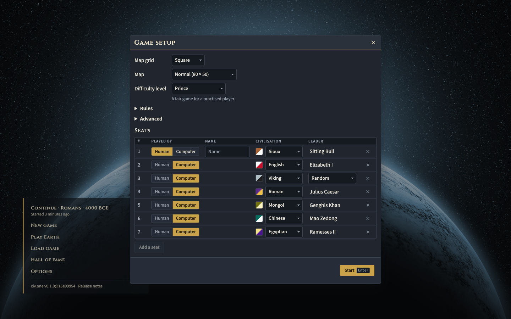
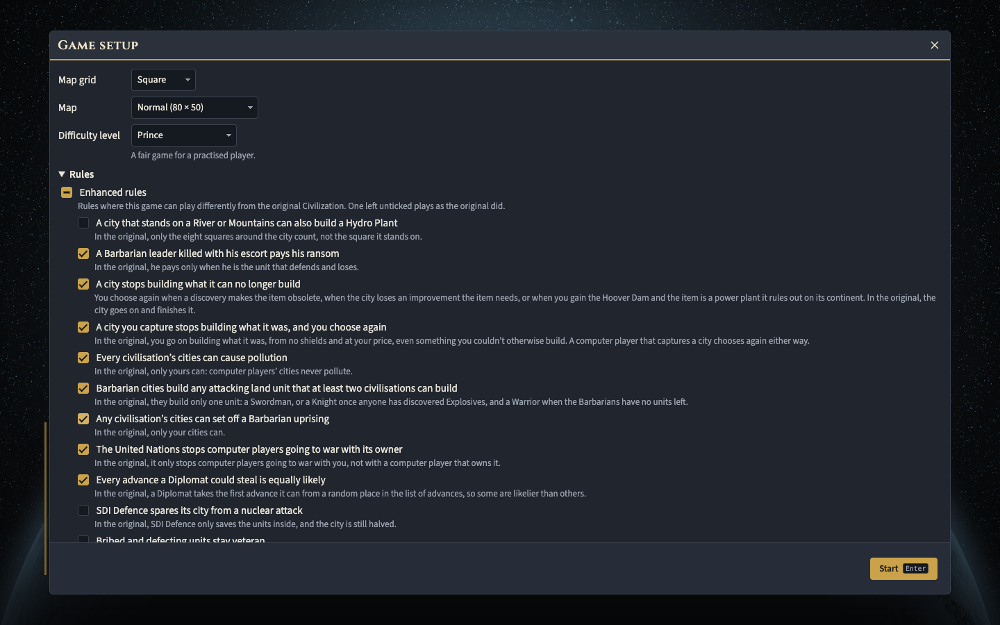
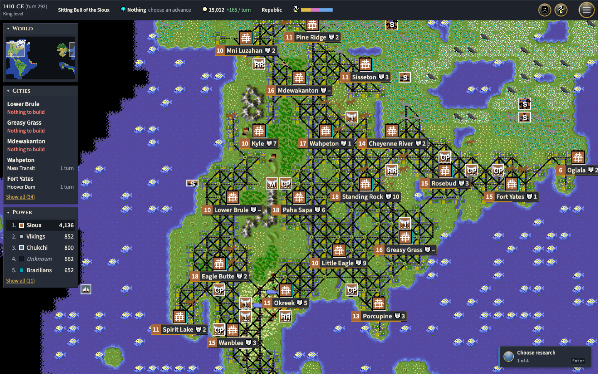
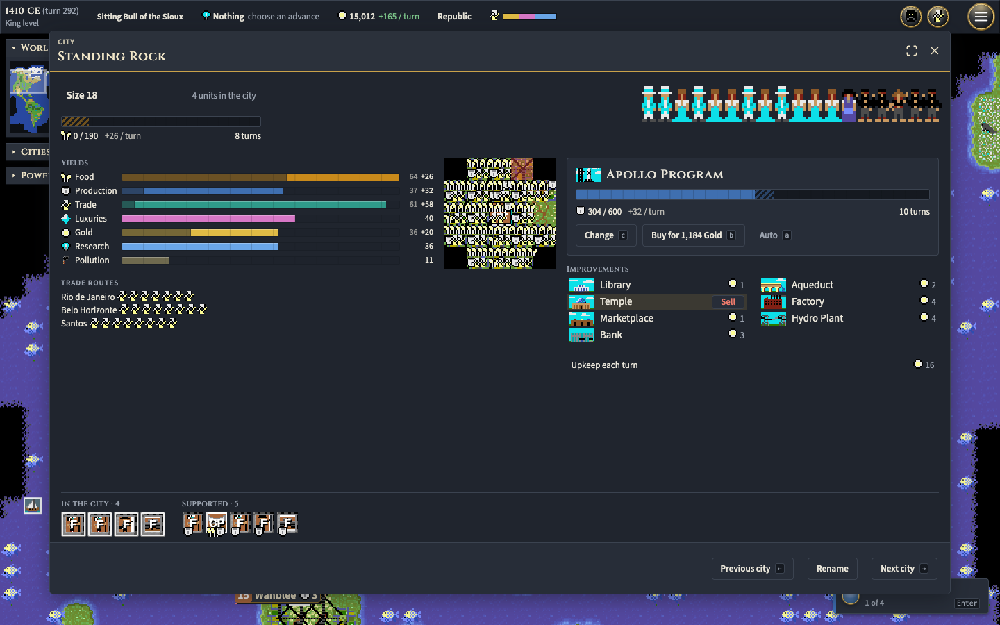
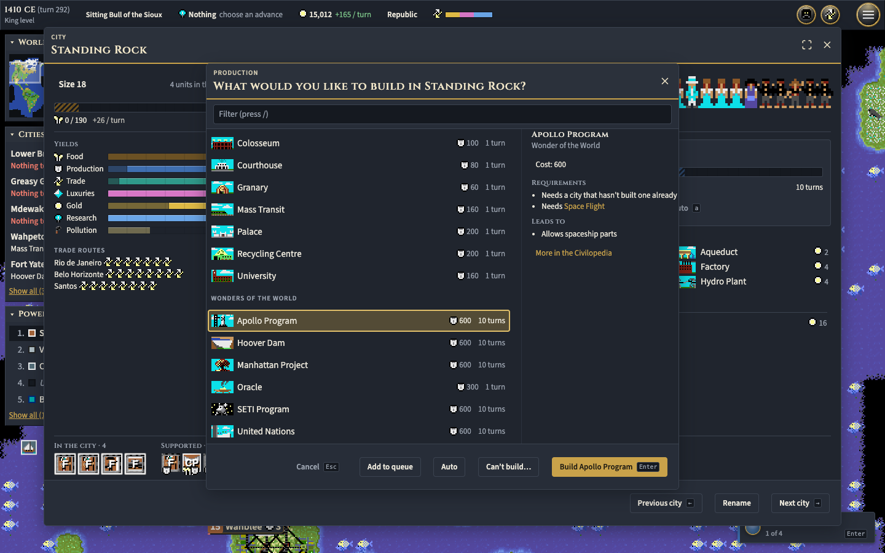
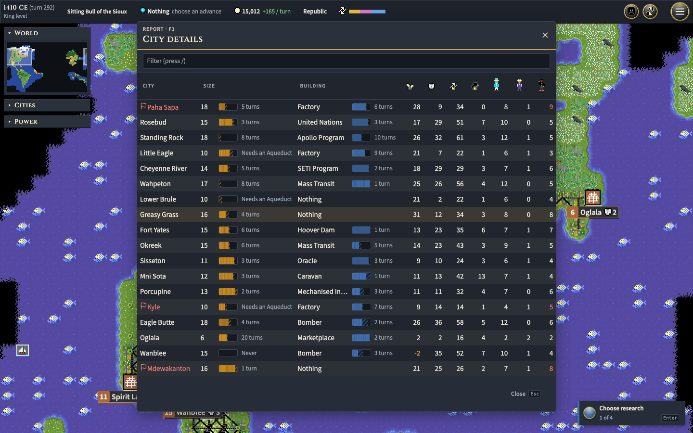
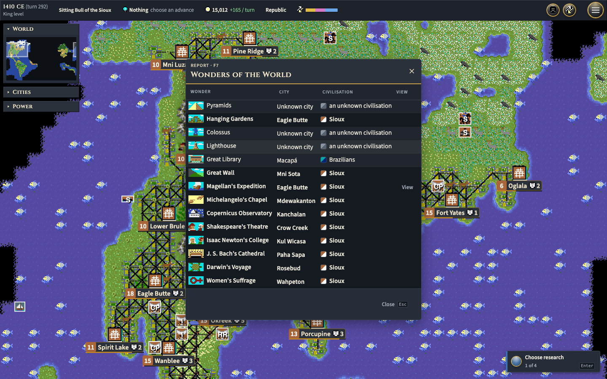
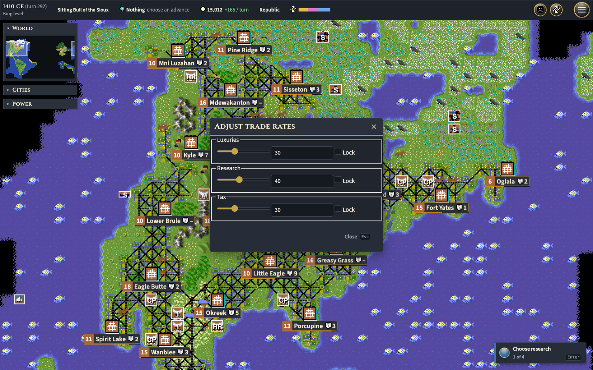
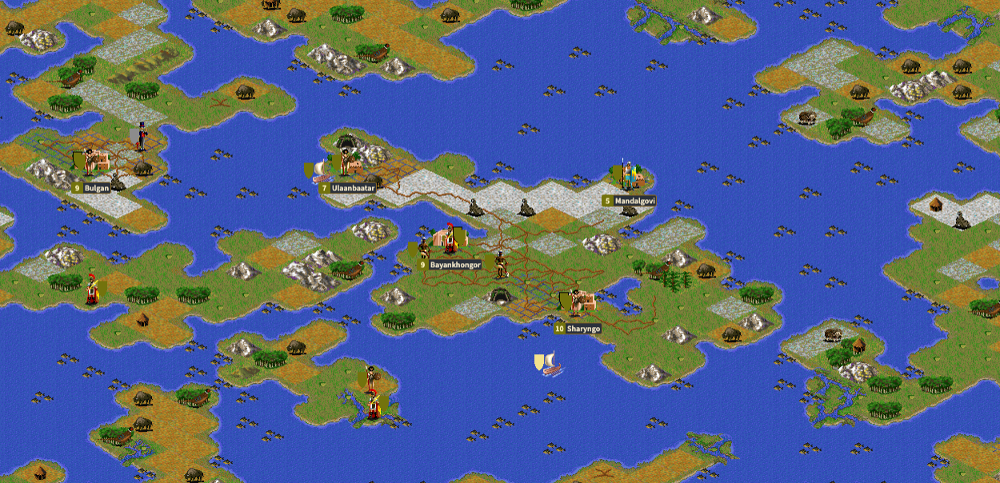
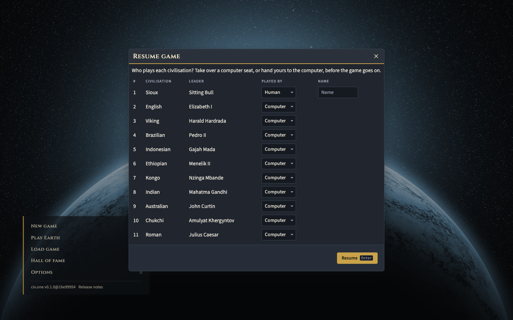
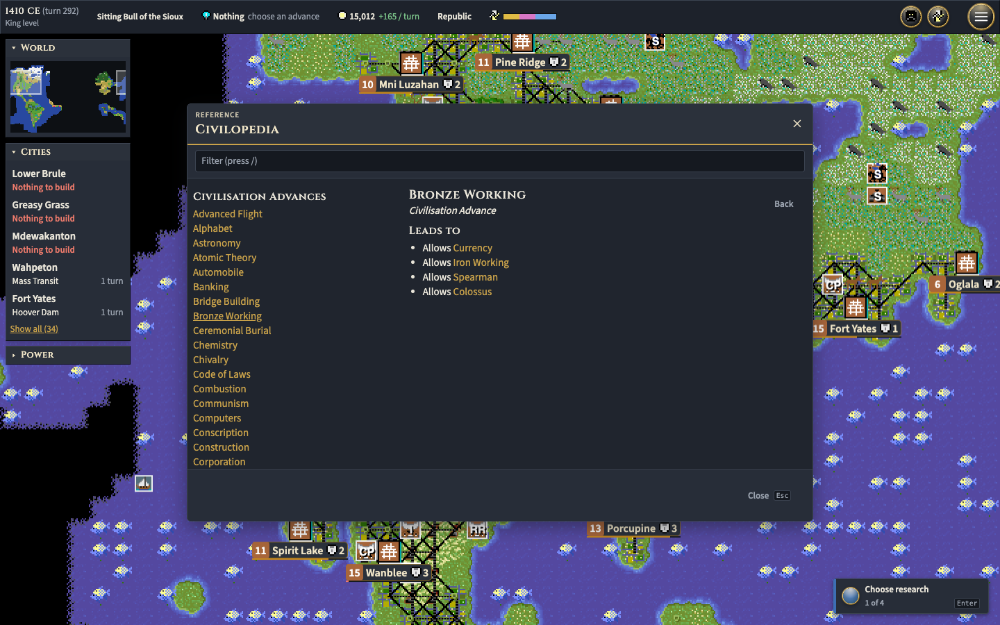

## Core concepts

**Packages.** A component's whole logic is a stand-alone package. `core-*`
packages expose base classes, interfaces and registries; `base-*` packages
hold the shared mechanisms and concrete things; `civ1-*` packages register
Civilization's own rules and content over them. A game is assembled from a
named set of packages: the renderer's `package.json` lists its sets
(Civilization, Civilization with the Enhanced rules, and a hidden Civilization
II one), the worker loads a set's packages when a game starts or loads, and a
save records the set it was played with.

**Rules.** `Rule`s control every interaction: how yields are counted and
accumulated, which governments are available, what a unit's attack, defence and
movement are, what a city can build, what happens when a player is defeated.
Each is `Criterion`s and `Effect`s registered with the game's rule registry, so
a package can add to, replace or disable another's behaviour.

**Engine and renderer.** The engine knows nothing of the page. The renderer
runs it in a Web Worker, sends the page what each player may see, and sends back
the player's actions; the computer players are clients of the same kind. That
is what will let a networked client be another kind of client.

## Get in touch

Ask anything in the organisation's
[discussions](https://github.com/civ-clone/civ-clone/discussions), or report a
problem on [`web-renderer`'s issues](https://github.com/civ-clone/web-renderer/issues),
whichever package turns out to be at fault: that is where the work is tracked.
Updates and screenshots go to the thread on
[CivFanatics](https://forums.civfanatics.com/threads/yet-anther-clone.680494/latest),
and the game shows its own release notes when you click the version in the corner
of the main menu.

## Contributing

Fork the repository in question, branch, make your change, and open a pull
request: against `main` for `web-renderer`, against `master` for an engine
package. The
[quick start](https://github.com/civ-clone/web-renderer/blob/main/docs/quick-start.md)
has the tooling and the checks each kind of change needs,
[`TODO.md`](./TODO.md) says where the project is and what is next, and
[`HISTORY.md`](./HISTORY.md) says how it got here, from 2016 on.
